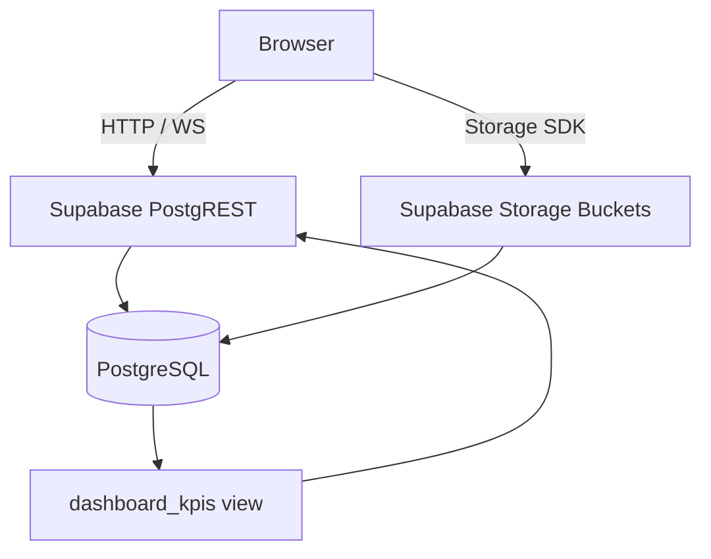
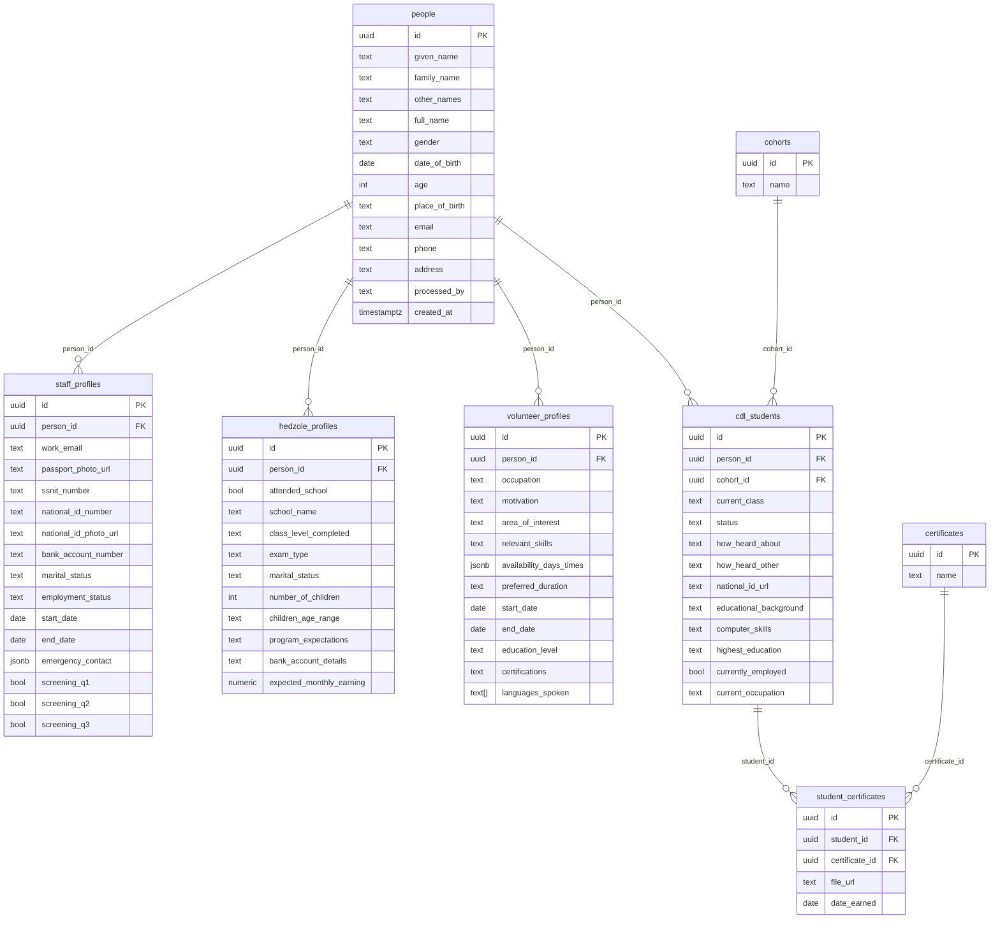

# Design Document

## Overview

The BASICS International People Data Collection & Analytics System is a single-page React/TypeScript web application built with Vite. It provides three core surfaces:

1. **Dashboard** -- an analytics page with KPI cards and six data-driven charts sourced from Supabase views and direct table queries.
2. **Data Collection Form** -- a multi-step, conditional intake wizard that creates a `Person` record and optionally creates one or more linked sub-profile records (Staff, Hedzole, Volunteer, CDL Student) in a single submission sequence.
3. **People List** -- a searchable, paginated table of all registered individuals with role badges.

All data persistence and storage is handled exclusively through the Supabase JS client (`@supabase/supabase-js` v2) located at `src/lib/supabase.ts`. There is no custom API layer; the frontend communicates directly with Supabase PostgREST endpoints and Storage buckets.

The application is designed to run in modern desktop and tablet browsers (viewport >= 768 px). The primary brand color is Deep Purple `#5B21B6`.

---

## Architecture

### High-Level Structure

```
src/
|-- lib/
|   \-- supabase.ts              # Supabase client singleton
|-- types/
|   \-- database.ts              # Generated / hand-maintained DB types
|-- hooks/
|   |-- useDashboardKpis.ts
|   |-- useChartData.ts
|   |-- usePeople.ts
|   \-- useLookups.ts            # cohorts, certificates
|-- components/
|   |-- layout/
|   |   |-- Sidebar.tsx
|   |   \-- AppShell.tsx
|   |-- dashboard/
|   |   |-- KpiCard.tsx
|   |   \-- ChartCard.tsx
|   |-- form/
|   |   |-- FormWizard.tsx       # step orchestrator
|   |   |-- StepIndicator.tsx
|   |   |-- CrossReferenceSearch.tsx
|   |   |-- ProgramSelector.tsx
|   |   |-- steps/
|   |   |   |-- Step1Person.tsx
|   |   |   |-- Step2Staff.tsx
|   |   |   |-- Step3Hedzole.tsx
|   |   |   |-- Step4Volunteer.tsx
|   |   |   \-- Step5Cdl.tsx
|   |   \-- FileUploadInput.tsx
|   \-- people/
|       |-- PeopleTable.tsx
|       |-- RoleBadge.tsx
|       \-- SearchBar.tsx
|-- pages/
|   |-- Dashboard.tsx
|   |-- Form.tsx
|   \-- People.tsx
\-- main.tsx                     # Router root
```

### Routing

React Router v6 with three top-level routes under the `AppShell` layout:

| Path | Component |
|------|-----------|
| `/` | `Dashboard` |
| `/form` | `Form` |
| `/people` | `People` |

### Data Flow



- **Read paths**: custom hooks call `supabase.from(...).select(...)`, managing `loading`, `error`, and `data` state locally.
- **Write paths**: form submission functions call `supabase.from(...).insert(...)` sequentially. Each insert awaits the previous result and aborts on any error, presenting the user with a targeted message.
- **Storage paths**: `supabase.storage.from(bucket).upload(path, file)` returns a `{ data, error }` pair; the public URL is retrieved with `getPublicUrl` and stored in the corresponding profile field.

---

## Components and Interfaces

### AppShell & Sidebar

`AppShell` renders the `Sidebar` on the left and the active route's page on the right via `<Outlet />`.

```typescript
// Sidebar props
interface SidebarProps {
  // No external props; reads current route internally with useLocation()
}

// Nav items configuration
const NAV_ITEMS = [
  { label: 'Dashboard', path: '/', icon: LayoutDashboard },
  { label: 'Register Person', path: '/form', icon: UserPlus },
  { label: 'People', path: '/people', icon: Users },
] as const;
```

Active link detection: `NavLink` from React Router with `isActive` prop -- applies `bg-purple-700 text-white` class, inactive links use `text-purple-200 hover:bg-purple-800`.

---

### Dashboard Page

Composes `KpiCard` components and `ChartCard` wrappers around Recharts charts.

```typescript
interface KpiCardProps {
  label: string;
  value: number;
  isLoading: boolean;
}

interface ChartCardProps {
  title: string;
  isLoading: boolean;
  isEmpty: boolean;
  hasError: boolean;
  children: React.ReactNode;
}
```

**KPI metrics** (sourced from `dashboard_kpis` view columns):
`total_people`, `total_cdl_students`, `total_staff`, `total_volunteers`, `total_hedzole_members`, `total_certificates_earned`, `networking_basics_count`, `modern_ai_count`.

**Charts** (6 total):

| # | Type | Data Source | X/Slice | Y/Value |
|---|------|-------------|---------|---------|
| 1 | Bar | `cdl_students` JOIN `cohorts` | Cohort name | Student count |
| 2 | Pie | `student_certificates` JOIN `certificates` | Certificate name | % of total |
| 3 | Bar | `cdl_students` | Computer skill level | Student count |
| 4 | Pie | `cdl_students` | How heard about program | % of total |
| 5 | Bar | `staff_profiles` | Employment status | Staff count |
| 6 | Bar | `volunteer_profiles` | Area of interest | Volunteer count |

All charts use `BRAND_COLOR = '#5B21B6'` as fill, with `<Tooltip />` enabled.

---

### Form Wizard (`FormWizard`)

The wizard holds a single `useForm<MasterFormSchema>` instance at the top level. Per-step validation is triggered by calling `form.trigger(stepFields)` before advancing.

```typescript
// Conceptual shape -- actual fields are spread across sub-schemas
interface MasterFormSchema {
  // Step 1
  given_name: string;
  family_name: string;
  other_names?: string;
  gender: 'Male' | 'Female' | 'Other';
  date_of_birth: string;          // ISO date string
  place_of_birth?: string;
  email?: string;
  phone: string;
  address?: string;
  processed_by: string;

  // Programs selected
  programs: {
    staff: boolean;
    hedzole: boolean;
    volunteer: boolean;
    cdl: boolean;
  };

  // Step 2 (Staff)
  ssnit_number?: string;
  national_id_number?: string;
  bank_account_number?: string;
  marital_status_staff?: string;
  employment_status?: string;      // required if staff
  start_date_staff?: string;       // required if staff
  end_date_staff?: string;
  emergency_contact?: EmergencyContact;
  screening_q1?: boolean;
  screening_q2?: boolean;
  screening_q3?: boolean;
  passport_photo_url?: string;     // set after upload
  national_id_photo_url?: string;  // set after upload

  // Step 3 (Hedzole)
  attended_school?: boolean;       // required if hedzole
  school_name?: string;
  class_level_completed?: string;
  exam_type?: string;
  marital_status_hedzole?: string; // required if hedzole
  number_of_children?: number;     // required if hedzole
  children_age_range?: string;
  program_expectations?: string;
  bank_account_details_hedzole?: string;
  expected_monthly_earning?: number;

  // Step 4 (Volunteer)
  occupation?: string;             // required if volunteer
  motivation?: string;
  area_of_interest?: string;
  relevant_skills?: string;
  availability_days_times?: AvailabilitySlot[];
  preferred_duration?: string;
  start_date_volunteer?: string;
  end_date_volunteer?: string;
  education_level?: string;
  certifications_volunteer?: string;
  languages_spoken?: string[];

  // Step 5 (CDL)
  cohort_id?: string;              // required if cdl
  current_class?: string;          // required if cdl
  cdl_status?: string;             // required if cdl
  how_heard_about?: string;        // required if cdl
  how_heard_other?: string;        // visible when how_heard_about === 'Other'
  computer_skills?: 'None' | 'Basic' | 'Intermediate' | 'Advanced';
  highest_education?: string;      // required if cdl
  currently_employed?: boolean;
  selected_certificates?: SelectedCertificate[];
}

interface EmergencyContact {
  name: string;
  phone: string;
  relationship: string;
}

interface AvailabilitySlot {
  day: string;
  start_time: string;
  end_time: string;
}

interface SelectedCertificate {
  certificate_id: string;
  file_url?: string;               // set after upload
  date_earned: string;             // required
}
```

**Step sequence logic:**

```typescript
function buildStepSequence(programs: MasterFormSchema['programs']): StepId[] {
  const steps: StepId[] = ['person'];  // Step 1 always present
  if (programs.staff)    steps.push('staff');
  if (programs.hedzole)  steps.push('hedzole');
  if (programs.volunteer) steps.push('volunteer');
  if (programs.cdl)      steps.push('cdl');
  return steps;
}
```

Program checkboxes are rendered before Step 1 submission. Unchecking a program calls `form.resetField` for all fields belonging to that step.

**Wizard state (local `useState` in `FormWizard`):**

```typescript
interface WizardState {
  currentStepIndex: number;
  stepSequence: StepId[];
  personId: string | null;        // set after Step 1 insert succeeds
  isSubmitting: boolean;
  submitError: string | null;
}
```

---

### CrossReferenceSearch

Debounced search (300 ms) with a minimum of 2 characters. Uses `useState` + `useEffect` for the debounce; does not use a library hook.

```typescript
interface CrossReferenceSearchProps {
  onSelect: (personId: string, displayLabel: string) => void;
  onRemove: (personId: string) => void;
  selectedLinks: Array<{ person_id: string; label: string }>;
  maxLinks?: number;  // default 20
}
```

Dropdown renders matches as `{ id, full_name, phone }`. On selection, adds a removable tag chip.

---

### FileUploadInput

```typescript
interface FileUploadInputProps {
  bucket: 'passport-photos' | 'national-ids' | 'certificates' | 'documents';
  accept: string;                 // e.g. 'image/jpeg,image/png,image/webp'
  maxSizeMb: number;              // 5
  label: string;
  onUploadComplete: (publicUrl: string) => void;
  onError: (message: string) => void;
}
```

Validation sequence on file selection:
1. Check `file.type` against allowed MIME types -- show error, block upload.
2. Check `file.size <= maxSizeMb * 1024 * 1024` -- show error, block upload.
3. Show preview (image thumbnail or filename for PDF).
4. Upload via `supabase.storage.from(bucket).upload(...)` on form advance or immediately (per step).

---

### PeopleTable

```typescript
interface Person {
  id: string;
  full_name: string;
  gender: string;
  phone: string;
  email: string | null;
  profiles: {
    has_staff: boolean;
    has_hedzole: boolean;
    has_volunteer: boolean;
    has_cdl: boolean;
  };
}

interface PeopleTableProps {
  people: Person[];
  isLoading: boolean;
  error: string | null;
  onRetry: () => void;
}
```

Search is client-side on the currently loaded page: `people.filter(p => p.full_name.toLowerCase().includes(query) || p.phone.includes(query))`, applied within 300 ms of the last keystroke via `useMemo` + debounce.

Pagination: controlled by `currentPage` and `pageSize = 50` state. Each page boundary triggers a new Supabase query with `.range(from, to)`.

---

## Data Models

### Supabase Table Overview



### TypeScript Database Types (`src/types/database.ts`)

```typescript
export interface Tables {
  people: PersonRow;
  staff_profiles: StaffProfileRow;
  hedzole_profiles: HedzoleProfileRow;
  volunteer_profiles: VolunteerProfileRow;
  cdl_students: CdlStudentRow;
  student_certificates: StudentCertificateRow;
  certificates: CertificateRow;
  cohorts: CohortRow;
}

export interface PersonRow {
  id: string;
  given_name: string;
  family_name: string;
  other_names: string | null;
  full_name: string;
  gender: string;
  date_of_birth: string;
  age: number | null;
  place_of_birth: string | null;
  email: string | null;
  phone: string;
  address: string | null;
  processed_by: string;
  created_at: string;
}
// ... (analogous interfaces for all other tables)
```

### Supabase Client (`src/lib/supabase.ts`)

```typescript
import { createClient } from '@supabase/supabase-js';

const supabaseUrl = import.meta.env.VITE_SUPABASE_URL;
const supabaseAnonKey = import.meta.env.VITE_SUPABASE_ANON_KEY;

if (!supabaseUrl || !supabaseAnonKey) {
  throw new Error(
    'Missing Supabase environment variables. ' +
    'Set VITE_SUPABASE_URL and VITE_SUPABASE_ANON_KEY in your .env file.'
  );
}

export const supabase = createClient(supabaseUrl, supabaseAnonKey);
```

The `throw` at module load time satisfies Requirement 1.5 -- the app halts before any data operation when credentials are absent.

### Form Submission Sequence

```typescript
async function submitForm(data: MasterFormSchema): Promise<void> {
  // 1. Insert person
  const { data: person, error: personError } = await supabase
    .from('people')
    .insert({ ...personFields(data) })
    .select('id')
    .single();
  if (personError) throw new SubmitStepError('person', personError.message);

  const personId = person.id;

  // 2. Insert selected sub-profiles in parallel is NOT used here;
  //    sequential inserts preserve error attribution per requirement 11.2
  if (data.programs.staff) {
    const { error } = await supabase
      .from('staff_profiles')
      .insert({ person_id: personId, ...staffFields(data) });
    if (error) throw new SubmitStepError('staff', error.message);
  }

  if (data.programs.hedzole) {
    const { error } = await supabase
      .from('hedzole_profiles')
      .insert({ person_id: personId, ...hedzoleFields(data) });
    if (error) throw new SubmitStepError('hedzole', error.message);
  }

  if (data.programs.volunteer) {
    const { error } = await supabase
      .from('volunteer_profiles')
      .insert({ person_id: personId, ...volunteerFields(data) });
    if (error) throw new SubmitStepError('volunteer', error.message);
  }

  if (data.programs.cdl) {
    const { data: cdlStudent, error: cdlError } = await supabase
      .from('cdl_students')
      .insert({ person_id: personId, ...cdlFields(data) })
      .select('id')
      .single();
    if (cdlError) throw new SubmitStepError('cdl', cdlError.message);

    // 3. Insert student_certificates
    for (const cert of data.selected_certificates ?? []) {
      const { error } = await supabase
        .from('student_certificates')
        .insert({
          student_id: cdlStudent.id,
          certificate_id: cert.certificate_id,
          file_url: cert.file_url ?? null,
          date_earned: cert.date_earned,
        });
      if (error) throw new SubmitStepError('student_certificates', error.message);
    }
  }
}

class SubmitStepError extends Error {
  constructor(public step: string, message: string) {
    super(message);
    this.name = 'SubmitStepError';
  }
}
```

---

## Correctness Properties

### Property 1: Required field rejection

*For any* form submission attempt where one or more of the required Step 1 fields (Given Name, Family Name, Gender, Date of Birth, Phone, Processed By) is empty or whitespace-only, the form SHALL reject the submission, display a validation error for each missing field, and leave the form on Step 1 with all previously entered values intact.

**Validates: Requirements 4.2, 4.3**

---

### Property 2: Email format validation

*For any* string entered into the Email field, the form SHALL accept only strings that match the pattern `local-part@domain` (at least one character before `@`, a `@`, and at least one character with a `.` after `@`), and SHALL reject all other strings with a validation error adjacent to the field.

**Validates: Requirements 4.7**

---

### Property 3: Date of Birth validity

*For any* date entered into the Date of Birth field, the form SHALL reject any date that is in the future or that would imply an age greater than 150 years, and display a validation error. Valid dates in the range [today - 150 years, today] SHALL be accepted without error.

**Validates: Requirements 4.8**

---

### Property 4: Program step inclusion/exclusion round-trip

*For any* combination of program checkboxes (Staff, Hedzole, Volunteer, CDL), the set of visible form steps SHALL exactly equal {person} union {programs checked}. Unchecking a program SHALL remove its step from the sequence and discard all data entered for that step; re-checking SHALL restore the step with empty fields.

**Validates: Requirements 6.1, 6.2, 6.3, 6.4, 6.5, 6.6, 6.7**

---

### Property 5: File type rejection

*For any* file selected for a Passport Photo or National ID upload whose MIME type is not `image/jpeg`, `image/png`, or `image/webp`, the form SHALL display a validation error adjacent to that input and SHALL NOT stage the file for upload or call `supabase.storage.upload`.

**Validates: Requirements 13.1, 13.2**

---

### Property 6: File size rejection

*For any* file selected for any upload input whose size exceeds 5 MB (5 x 1024 x 1024 bytes), the form SHALL display a validation error adjacent to that input and SHALL NOT stage the file for upload.

**Validates: Requirements 13.4**

---

### Property 7: Volunteer date ordering

*For any* volunteer step submission, if both Start Date and End Date are provided, the End Date SHALL be on or after the Start Date. Any combination where End Date is strictly before Start Date SHALL be rejected with a validation error.

**Validates: Requirements 9.3**

---

### Property 8: Cross-reference search results containment

*For any* query string of 2 or more characters entered into the Cross Reference search bar, every record returned in the dropdown SHALL have a `full_name` field that contains the query string (case-insensitive). No record whose `full_name` does not contain the query SHALL appear in the dropdown.

**Validates: Requirements 5.1, 5.2**

---

### Property 9: Cross-reference selection cap

*For any* sequence of person selections in the Cross Reference component, the total number of selected relationship links SHALL never exceed 20. Any attempt to add a 21st selection SHALL be ignored and the existing 20 links SHALL remain unchanged.

**Validates: Requirements 5.4**

---

### Property 10: KPI null coercion

*For any* response from the `dashboard_kpis` view where one or more metric columns contain a null value, the Dashboard SHALL render zero (0) for that KPI card's numeric value rather than null, undefined, or NaN.

**Validates: Requirements 2.6**

---

### Property 11: Retry cap disables action

*For any* sequence of 3 consecutive failed retry attempts on the Dashboard KPI fetch, the retry button SHALL be disabled and a permanent failure message SHALL be displayed. A 4th or subsequent click SHALL produce no network request.

**Validates: Requirements 2.7**

---

### Property 12: CDL certificate file upload per certificate

*For any* set of certificates selected in Step 5, the form SHALL render exactly one file upload input per selected certificate, and the `student_certificates` insert SHALL include exactly one row per selected certificate, each containing the `certificate_id`, `file_url`, and `date_earned` entered for that certificate.

**Validates: Requirements 10.6, 10.10**

---

### Property 13: Hedzole school field conditional visibility

*For any* Hedzole step state where `attended_school` is `false`, the School Name and Class Level Completed fields SHALL be hidden from the DOM and their values SHALL be cleared (not submitted). When `attended_school` switches to `true`, the fields SHALL reappear empty.

**Validates: Requirements 8.2**

---

### Property 14: People list search filter correctness

*For any* search query entered into the People List search bar, every record displayed in the table SHALL have a `full_name` or `phone` that contains the query string (case-insensitive), and no record that does not match SHALL appear in the filtered result.

**Validates: Requirements 12.4, 12.5**

---

## Error Handling

### Supabase Error Response Pattern

Every Supabase call returns `{ data, error }`. The pattern used throughout the app:

```typescript
const { data, error } = await supabase.from('...').select('...');
if (error) {
  // surface error to UI state; do not throw unless inside a submit sequence
  setError(error.message);
  return;
}
```

Inside the sequential submit sequence, errors are thrown as `SubmitStepError` and caught at the wizard level to attribute the failure to the correct step.

### Error States by Component

| Component | Error Trigger | User-Facing Response |
|-----------|--------------|----------------------|
| `AppShell` | Missing env vars | Full-page error before mount |
| `KpiCard` | `dashboard_kpis` fetch fails | Error message + retry button; disabled after 3 failures |
| `ChartCard` | Chart query fails | Error message inside chart container; other charts unaffected |
| `Step1Person` | `people` insert fails | Inline error; all field values retained; retry allowed |
| `StepXxx` | Sub-profile insert fails | Inline error; all field values retained; retry allowed |
| `FileUploadInput` | Upload fails | Error adjacent to input; other fields retained |
| `CrossReferenceSearch` | Query error or timeout >3000 ms | Error message in dropdown; existing selections preserved |
| `PeopleTable` | Fetch fails | Human-readable error + retry action |
| Cohort/Certificate lookup | Fetch fails | Warning adjacent to field; field disabled until retry |

### Retry Logic

- **Dashboard KPI fetch**: counter in `useState`; increments on each manual retry; disables button after 3.
- **Form inserts**: no automatic retry; user re-clicks submit. `isSubmitting` flag prevents double-submission.
- **File uploads**: user re-selects or re-triggers upload per input; no global retry gate.
- **Lookup tables**: "Retry" button re-fires the lookup fetch; field re-enables on success.

### Loading States

| Location | Indicator |
|----------|-----------|
| KPI Cards | Skeleton placeholder per card |
| Charts | Spinner/skeleton inside each `ChartCard` |
| People Table | Skeleton rows |
| Cohort / Certificate dropdowns | Spinner inside the select |
| Cross Reference dropdown | Spinner while query is in flight |
| Form submit button | Spinner + disabled state |

---

## Testing Strategy

### Unit Tests (Vitest + React Testing Library)

Unit tests focus on validation logic, conditional rendering, and data transformation -- areas where concrete examples add clarity.

**Key areas:**
- `buildStepSequence`: test each combination of program flags returns the correct ordered step array.
- Validation functions for email format, date-of-birth range, file type, file size.
- `submitForm` orchestrator: mock Supabase client to verify the correct insert sequence and that a failure at any step throws `SubmitStepError` with the right `step` attribute.
- `KpiCard` rendering: null/undefined metric values render as `0`.
- `CrossReferenceSearch`: verify selection cap at 20, remove tag behavior, "No matching records" display.
- `PeopleTable` search: filter returns only matching records.
- `FileUploadInput`: rejected MIME types and oversized files produce error state without calling `supabase.storage`.
- Retry counter: verify disable after 3 attempts, no further network calls.

### Property-Based Tests (fast-check)

The property-based testing library for this project is **[fast-check](https://fast-check.dev/)** (TypeScript-native, runs in Vitest).

Each property test is configured to run a minimum of **100 iterations** (`numRuns: 100`).

Tag format for traceability:
```
// Feature: onebasics-app, Property {N}: {property_text}
```

| Property # | Test description | Arbitraries |
|------------|-----------------|-------------|
| 1 | Required field rejection | `fc.record` with arbitrary whitespace/empty combinations for required fields |
| 2 | Email format validation | `fc.string()` -- valid emails pass, invalid strings fail |
| 3 | Date of Birth validity | `fc.date()` -- future dates and >150-year-old dates rejected |
| 4 | Program step inclusion/exclusion | `fc.record({ staff: fc.boolean(), hedzole: fc.boolean(), volunteer: fc.boolean(), cdl: fc.boolean() })` |
| 5 | File type rejection | `fc.constantFrom(...)` over non-allowed MIME types |
| 6 | File size rejection | `fc.integer({ min: 5 * 1024 * 1024 + 1, max: 100 * 1024 * 1024 })` for file sizes |
| 7 | Volunteer date ordering | `fc.tuple(fc.date(), fc.date())` -- verify end < start is rejected |
| 8 | Cross-reference search containment | `fc.string()` query + `fc.array` of person records |
| 9 | Cross-reference selection cap | `fc.array(fc.uuid(), { minLength: 21, maxLength: 50 })` attempts |
| 10 | KPI null coercion | `fc.record` with nullable numeric fields |
| 11 | Retry cap disables action | `fc.integer({ min: 3, max: 10 })` retry sequences |
| 12 | CDL certificate per-certificate row | `fc.array(fc.uuid(), { minLength: 1, maxLength: 16 })` certificate selections |
| 13 | Hedzole school field conditional | `fc.boolean()` for `attended_school`, arbitrary school field values |
| 14 | People list search filter | `fc.string()` query + `fc.array` of person records |

### Integration Tests

Integration tests run against a Supabase local development instance (`supabase start`):
- End-to-end form submission: person + at least one sub-profile created, `student_certificates` rows match selected certificates.
- Dashboard KPI view: view returns expected shape after inserting test data.
- People List pagination: 60 test records, verify page 1 returns 50, page 2 returns 10.
- Storage uploads: verify file appears in the correct bucket after upload.
